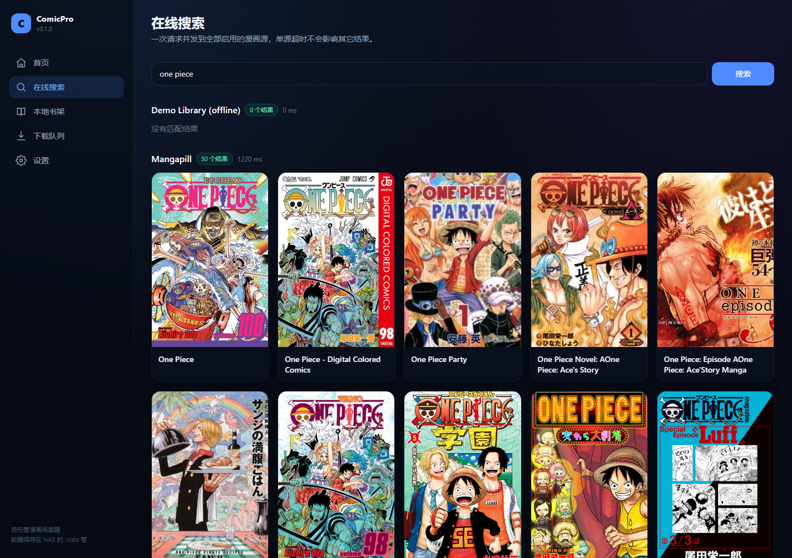
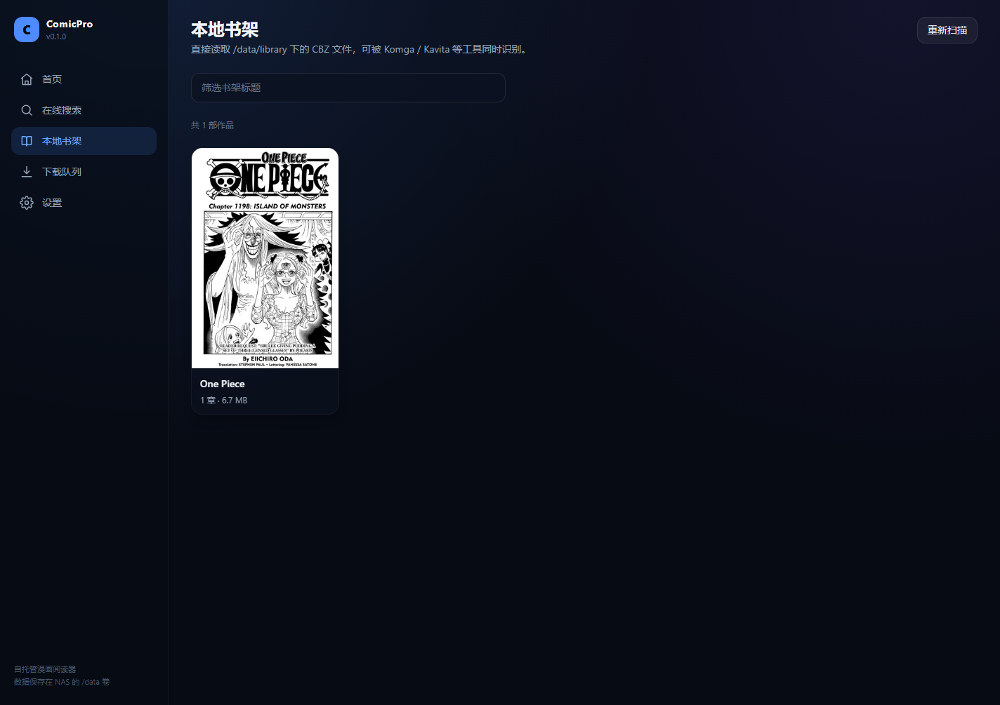

# ComicPro

自托管 Web 漫画阅读器：**多源搜索 → 在线阅读 → 下载 CBZ → 本地书架**，一个 Docker 容器跑在 NAS 上。

- 输入关键词，一次请求并发搜索所有启用的漫画源，单源超时/报错不影响其它结果
- 内置 **Mangapill**、**Weeb Central** 与 **咚漫（简体中文）** 三个真实源（HTML 抓取，无需浏览器），以及 **nhentai**（NSFW，API v2），开箱即可搜索、阅读、下载；另有离线 Demo 源用于验证链路
- 在线阅读走**签名图片代理**，自动带 Referer / Cookie，解决防盗链与跨域
- 章节勾选下载（或整部下载），持久化队列、断点续传、失败重试
- 下载产物为标准 **CBZ**（含 `ComicInfo.xml`），Komga / Kavita 等可同时识别
- 本地书架直接从 `/data/library` 读取，断网也能看
- 单密码访问控制（可选），`PUID/PGID` 适配群晖 / QNAP / Unraid / TrueNAS
- 多架构镜像：`linux/amd64`、`linux/arm64`


## 快速开始

```bash
git clone <this-repo> comicpro && cd comicpro
docker compose up -d --build
# 打开 http://NAS-IP:8080
```

`./data` 会自动创建，包含数据库、书架、缓存与源配置。更新代码后重新 `docker compose up -d --build` 即可，数据不受影响。

首次打开可以直接搜索 `star`（Demo 源，离线）或 `one piece`（英文源）、`恋爱`（咚漫简体中文源），验证搜索、阅读、下载、书架全链路。

## 内置漫画源

| id | 站点 | 语言 | 实现 | 默认 |
| --- | --- | --- | --- | --- |
| `mangapill` | https://mangapill.com | en | HTML（搜索 / 章节列表 / `img.js-page`） | 启用 |
| `weebcentral` | https://weebcentral.com | en | HTML（HTMX 搜索片段 / 全量章节列表 / 图片片段） | 启用 |
| `dongman` | https://www.dongmanmanhua.cn | zh | HTML（官方简体条漫：搜索 / 详情 / 阅读页 `data-url`） | 启用 |
| `nhentai` | https://nhentai.net | ja | API v2（`/api/v2/search`、`/api/v2/galleries/{id}`、CDN 配置） | 启用（NSFW） |
| `demo` | 本地生成 | — | Python 占位页 | 启用 |

关闭真实源：`COMICPRO_MANGAPILL=0`、`COMICPRO_WEEBCENTRAL=0`、`COMICPRO_DONGMAN=0`、`COMICPRO_NHENTAI=0`，或直接在设置页切换。搜索结果与设置页会给 NSFW 源显示红色标记。

nhentai 支持站点标签语法，例如 `language:chinese yuri`、`artist:name`；公共接口有每分钟请求数限制，应用内已做节流与 429 退避。真实源的可用性取决于部署网络与站点本身；站点改版时更新 `backend/app/sources/` 下对应适配器即可（接口契约见 [docs/SOURCES.md](docs/SOURCES.md#内置源)）。

## 使用流程

1. **在线搜索**：输入标题/关键词 → 结果按源分组，显示每个源的耗时与错误。自动从 [Bangumi](https://bgm.tv/) 查询同一作品的中、英、日文名称，例如「火影忍者」也会搜索 `NARUTO`，反向亦然；无需维护名称对照表。
2. **漫画详情**：查看章节列表；可「下载全部」、勾选后「下载所选」，或「关注追更 + 自动下载」。
3. **阅读**：分页 / 条漫两种模式，支持 RTL、适宽/适高、键盘 `← →`、`空格`、`F` 全屏；进度自动保存。
4. **下载队列**：实时进度（SSE），可取消、重试；容器重启后自动继续。
5. **本地书架**：下载完成的 CBZ 自动入库，按作品聚合；可直接阅读、删除。
6. **设置**：启用/停用源、在线编辑 YAML、粘贴站点地址自动识别引擎、缓存上限、追更间隔、访问密码。

| 搜索 | 详情 |
| --- | --- |
|  |  |

| 书架 | 阅读器 |
| --- | --- |
|  |  |

## 添加漫画源

内置三种声明式引擎：`madara`（WordPress Madara 主题）、`mangastream`、`generic`（任意 CSS 选择器）。

**方式一：自动识别** — 设置页「添加源」填入站点首页，识别引擎后直接保存启用。

**方式二：手写 YAML** — 放到 `/data/config/sources/*.yaml`，或在设置页编辑。最小配置（Madara）：

```yaml
id: my-madara
name: My Site
engine: madara
base_url: https://manga.example.org
enabled: true
```

完整选择器语法、懒加载图片、分页、Cookie 与调试方法见 [docs/SOURCES.md](docs/SOURCES.md)。

> 源配置由部署者自行维护；应用只负责抓取与展示。

## 环境变量

| 变量 | 默认 | 说明 |
| --- | --- | --- |
| `PUID` / `PGID` | `1000` | 运行用户，需与 NAS 上 `data` 目录属主一致 |
| `PORT` | `8080` | 容器内监听端口 |
| `COMICPRO_DATA_DIR` | `/data` | 数据根目录（db / library / cache / config） |
| `COMICPRO_AUTH_PASSWORD` | 空 | 设置后启用登录；优先于 UI 中保存的密码 |
| `COMICPRO_API_TOKEN` | 空 | 请求头 `X-Api-Token`，供脚本/自动化放行 |
| `COMICPRO_BASE_PATH` | 空 | 反向代理子路径，例如 `/comic`（代理需剥离前缀） |
| `COMICPRO_CACHE_MAX_GB` | `5` | 在线阅读图片磁盘缓存上限（LRU 清理） |
| `COMICPRO_DOWNLOAD_CONCURRENCY` | `2` | 同时下载的章节数 |
| `COMICPRO_PAGE_CONCURRENCY` | `6` | 单章页级并发（全局信号量） |
| `COMICPRO_DEMO_SOURCE` | `1` | 是否注册离线 Demo 源 |
| `COMICPRO_MANGAPILL` | `1` | 是否注册 Mangapill 真实源 |
| `COMICPRO_WEEBCENTRAL` | `1` | 是否注册 Weeb Central 真实源 |
| `COMICPRO_DONGMAN` | `1` | 是否注册咚漫（简体中文）真实源 |
| `COMICPRO_NHENTAI` | `1` | 是否注册 nhentai（NSFW）真实源 |
| `COMICPRO_CHECK_INTERVAL_MIN` | `360` | 关注漫画的追更检查间隔，`0` 关闭 |
| `COMICPRO_SOURCE_TIMEOUT` | `8` | 单源请求超时（秒） |
| `COMICPRO_SEARCH_TIMEOUT` | `12` | 搜索总超时（秒） |
| `COMICPRO_BANGUMI_ENABLED` | `1` | 自动从 Bangumi 查询作品名称与别名，`0` 关闭 |
| `COMICPRO_BANGUMI_TIMEOUT` | `2` | 名称查询总时限（秒，包含搜索与详情） |
| `COMICPRO_BANGUMI_CACHE_TTL` | `86400` | 名称查询的内存缓存有效期（秒，重启清空） |
| `COMICPRO_HTTP_PROXY` | 空 | 抓取源站/图片时使用的 HTTP 代理 |
| `COMICPRO_LOG_LEVEL` | `INFO` | 日志级别 |

运行设置页里可以改缓存上限与追更间隔（写入数据库，重启保留）；其余参数以环境变量为准。

跨语言搜索只使用名称吻合的漫画主条目；别名是否齐全取决于 Bangumi 的收录。每个源保留原关键词，并最多额外查询两个别名，合并同源重复结果。Bangumi 查询与原关键词搜索同时开始，超时或不可用时保留原搜索结果；仅启用 Demo 源、没有启用源或使用 `language:chinese` 等搜索语法时不请求 Bangumi。名称缓存最多 512 项，未匹配缓存 5 分钟，查询失败缓存 30 秒，并遵守 HTTP 429 的重试间隔。查询通过后端及其 HTTP 代理发送到 Bangumi，无需 API key。

## 数据目录

```
/data
├── db/comicpro.db          # SQLite（漫画、章节、任务、进度、设置）
├── library/<source>/<series>/0001 xxx.cbz
├── cache/pages/            # 在线阅读缓存（可随时删除）
├── cache/covers/           # 书架封面缩略图（可随时删除）
└── config/
    ├── secret.key          # 会话/图片签名密钥（首次启动生成）
    └── sources/*.yaml      # 你自己的源配置
```

备份只需要复制整个 `data` 目录；恢复时原样放回即可。

## NAS 部署

群晖、Unraid、TrueNAS、QNAP 的详细步骤（含 `docker compose` 片段、权限、反向代理、arm64 构建）见 [docs/DEPLOY.md](docs/DEPLOY.md)。

Synology Container Manager「项目」直接粘贴 `docker-compose.yml` 即可；记得把 `PUID/PGID` 改成 `id` 命令看到的用户。

## 反向代理与子路径

推荐给应用一个域名并启用 HTTPS。子路径部署示例（Nginx）：

```nginx
location /comic/ {
    proxy_pass http://NAS_IP:8080/;   # 末尾斜杠 = 剥离 /comic 前缀
    proxy_set_header Host $host;
    proxy_set_header X-Forwarded-For $proxy_add_x_forwarded_for;
    proxy_set_header X-Forwarded-Proto $scheme;
    proxy_buffering off;              # 下载进度 SSE
}
```

同时设置 `COMICPRO_BASE_PATH=/comic`，前端资源、路由、Cookie 路径都会自动适配。

## 本地开发

需要 Python 3.11+、Node 20+、[uv](https://docs.astral.sh/uv/)、pnpm。

```bash
uv sync --group dev
pnpm -C frontend install

# 终端 1：后端（需要前端已构建，或使用 Vite 开发服务器）
pnpm -C frontend build
uv run uvicorn app.main:create_app --factory --app-dir backend --reload --port 8080

# 终端 2：前端热更新
pnpm -C frontend dev        # http://localhost:5173，/api 代理到 8080
```

验证：

```bash
uv run ruff check backend
uv run pytest -q
pnpm -C frontend run typecheck
pnpm -C frontend run build
powershell -NoProfile -ExecutionPolicy Bypass -File scripts/smoke.ps1   # 需要 Docker：构建镜像并跑端到端冒烟
```

## 目录结构

```
backend/app/
  api/          # FastAPI 路由（search / sources / downloads / library / reader ...）
  services/     # 下载引擎、CBZ、缓存、图片代理、鉴权、追更、库扫描
  sources/      # 源框架：YAML 引擎、Madara / MangaStream 预设、Demo、probe
  main.py       # 应用工厂与生命周期
frontend/src/   # React + Vite + Tailwind（页面、阅读器、API 层）
docker/         # entrypoint（PUID/PGID、gosu、tini）
docs/           # 架构、源编写、部署文档
```

## API 速览

| 方法 | 路径 | 说明 |
| --- | --- | --- |
| GET | `/api/health` | 健康检查（版本、磁盘、队列、源状态） |
| GET | `/api/search?q=` | 多源并发搜索 |
| GET | `/api/sources` | 源列表与启用状态 |
| POST | `/api/sources/probe` | 站点指纹识别 → YAML 草稿 |
| GET | `/api/sources/{id}/manga/{key}` | 详情 + 章节（并入库） |
| POST | `/api/sources/{id}/manga/{key}/follow` | 关注 / 自动下载 |
| POST | `/api/downloads` | 入队（章节 ID 或整部） |
| GET | `/api/downloads` / `/stream` | 队列 / SSE 进度 |
| GET | `/api/library` | 本地书架 |
| GET | `/api/read/online` · `/api/read/library` | 阅读清单 |
| GET | `/api/img?u=&s=&e=&sig=` | 签名图片代理 |

接口文档：`http://NAS-IP:8080/docs`（Swagger）。

## 故障排查

| 现象 | 处理 |
| --- | --- |
| 某源搜索报 `403` / `SOURCE_BLOCKED` | 该站需要浏览器校验或 Cookie；在源 YAML 的 `headers` / `cookies` 中补充，或换源 |
| 真实源全部超时 / DNS 失败 | 部署环境无法访问该站（区域/网络限制）；停用该源，或为容器设置 `COMICPRO_HTTP_PROXY` |
| 下载全部失败 | 点开队列里的错误信息；先确认单章在线阅读是否正常，再检查磁盘余量 |
| `/data` 权限错误 | 把 `PUID/PGID` 改成 `data` 目录属主（群晖常见 `1026:100`） |
| 子路径部署白屏 | 确认反向代理剥离了前缀，且设置了 `COMICPRO_BASE_PATH` |
| 内存占用高 | 降低 `COMICPRO_DOWNLOAD_CONCURRENCY` / `PAGE_CONCURRENCY`，并调小缓存上限 |
| 想看抓取细节 | `COMICPRO_LOG_LEVEL=DEBUG` 后 `docker compose logs -f` |

## 技术栈

FastAPI · SQLAlchemy (async SQLite) · httpx · selectolax · Pillow · React 18 · Vite · Tailwind · TanStack Query。阅读器与下载器均为纯 Python 实现，无浏览器依赖，适合长期跑在低功耗 NAS 上。
